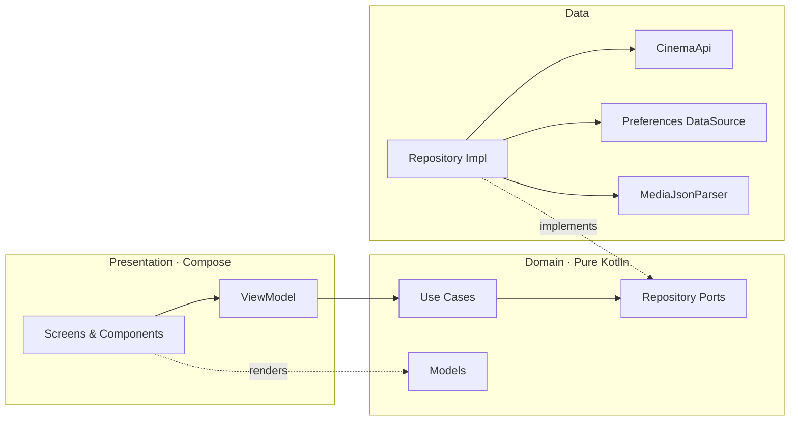

<div align="center">

<h1>نماگر</h1>

<p><strong>سینمای ایران، در یک تجربهٔ تماشای سینمایی</strong></p>

<p><sub>Namager · Persian Cinema for Android</sub></p>

<p>
  
  
  
  
</p>

<p>
  
  
  
  
</p>

</div>

---

## فهرست مطالب

| # | بخش | # | بخش |
|:--:|:---|:--:|:---|
| ۱ | [عنوان و شعار پروژه](#title) | ۵ | [پشته فناوری](#stack) |
| ۲ | [نگاه کلی](#overview) | ۶ | [شروع به کار](#setup) |
| ۳ | [اصول طراحی UX/UI](#ux) | ۷ | [ویژگی‌ها و نحوه استفاده](#usage) |
| ۴ | [کد تمیز و معماری](#architecture) | ۸ | [مشارکت و مجوز](#contributing) |

---

<a name="title"></a>

## ۱. عنوان و شعار پروژه (Title & Tagline)

**نماگر** یک اپلیکیشن بومی اندروید برای کشف، جستجو، نشان‌کردن و تماشای فیلم و سریال است؛ ساخته‌شده برای مخاطب فارسی‌زبان و طراحی‌شده از پایه برای چیدمان راست‌به‌چپ.

> **«سینمای ایران، در یک تجربهٔ تماشای سینمایی.»**

نام «نماگر» از «نما» — تصویر و قاب سینمایی — و پسوند «گر» ساخته شده است: ابزاری برای دیدن و کشف سینما. در مستندات و کد، پروژه با نام **Namager** شناخته می‌شود.

| فارسی‌اول | سینمایی | مهندسی‌شده |
|:---|:---|:---|
| رابط کامل RTL، اعداد فارسی، فونت وزیرمتن و متن‌های بومی | تم تاریک، پوستر تمام‌قد، هیرو تصویری و پالت نارنجی/طلایی | مرزهای روشن لایه‌ها، تست‌پذیری و کدی که می‌شود روی آن ساخت |

---

<a name="overview"></a>

## ۲. نگاه کلی (Overview)

کاتالوگ فیلم و سریال فارسی معمولاً بین وب‌سایت‌های پراکنده، لینک‌های ناپایدار و رابط‌هایی که برای راست‌به‌چپ طراحی نشده‌اند تقسیم می‌شود. نماگر این تجربه را در یک اپلیکیشن بومی، سریع و یکدست جمع می‌کند: مرور منظم کاتالوگ، جستجوی لحظه‌ای، صفحهٔ جزئیات کامل، پخش آنلاین با انتخاب کیفیت و کتابخانهٔ شخصی از علاقه‌مندی‌ها.

### هدف پروژه

- **کشف آسان:** فهرست‌های تفکیک‌شدهٔ فیلم و سریال، فیلتر ژانر، مرتب‌سازی و هیرو منتخب.
- **تماشای روان:** پخش با Media3 ExoPlayer، انتخاب کیفیت، سرعت پخش و مدیریت چرخهٔ عمر.
- **کتابخانهٔ شخصی:** علاقه‌مندی‌ها، گروه‌بندی دلخواه و نشان‌گذاری قسمت‌های دیده‌شده.
- **تجربهٔ بومی:** رابط فارسی RTL، اعداد فارسی و جزئیات بصری هماهنگ با سینما.

### ارزش افزوده

| ارزش | توضیح |
|:---|:---|
| **یکپارچگی** | مرور، جستجو، جزئیات، پخش و کتابخانه در یک جریان پیوسته — بدون پرش بین اپ‌ها |
| **فارسی‌اول** | RTL واقعی (نه فقط ترجمه)، اعداد فارسی، فونت وزیرمتن و متن‌های کاربرپسند خطا |
| **تجربهٔ سینمایی** | تم تاریک، تصاویر بزرگ، هیرو چرخشی و سلسله‌مراتب بصری مبتنی بر محتوا |
| **معماری تمیز** | دامنهٔ خالص Kotlin، MVVM، جریان دادهٔ یک‌طرفه و مرزهای قابل تست |
| **عملکرد** | بارگذاری تطبیقی تصاویر، لیست‌های lazy، توقف انیمیشن‌های خارج از دید و پخش بهینه |

### نماگر برای چه کسانی است؟

- **بینندهٔ فارسی‌زبان** که می‌خواهد سریع به فیلم یا سریال مورد نظرش برسد.
- **توسعه‌دهندهٔ اندروید** که دنبال نمونه‌ای عملی از Compose + Clean Architecture + Hilt است.
- **طراح محصول** که به الگوهای RTL، دسترس‌پذیری و طراحی محتوا‌محور علاقه دارد.

> [!NOTE]
> **وضعیت پروژه:** نسخهٔ `1.0` مسیرهای اصلی — مرور، جستجو، جزئیات، پخش، علاقه‌مندی‌ها و تنظیمات — را پوشش می‌دهد. پروژه در حال توسعهٔ فعال است و ممکن است جزئیات API یا ساختار داخلی تغییر کند.

### در یک نگاه

| مورد | مقدار |
|:---|:---|
| پلتفرم | اندروید ۷.۰ (API 24) به بالا؛ هدف API 36 (اندروید ۱۶) |
| زبان رابط | فارسی، راست‌به‌چپ |
| معماری | Clean Architecture + MVVM + جریان دادهٔ یک‌طرفه |
| رابط کاربری | Jetpack Compose + Material 3 |
| تزریق وابستگی | Hilt (KSP) |
| پخش ویدیو | AndroidX Media3 ExoPlayer |
| نسخه | `1.0` (versionCode `1`) |
| وضعیت | توسعهٔ فعال |

<details>
<summary><strong>English summary</strong></summary>

**Namager** is a native Android app for discovering, searching, bookmarking, and streaming Persian films and series. It is Persian-first and RTL-native, built with Kotlin, Jetpack Compose, Material 3, Hilt, and Media3. The codebase follows Clean Architecture with a pure-Kotlin domain layer, MVVM with unidirectional state flow, repository ports, typed errors, and extensive attention to adaptive layout, accessibility, and playback performance.

</details>

---

<a name="ux"></a>

## ۳. اصول طراحی UX/UI

طراحی نماگر بر یک باور ساده استوار است: **رابط کاربری نباید بین کاربر و فیلم بایستد.** هر تصمیم بصری و تعاملی با سه پرسش سنجیده می‌شود: آیا محتوا واضح‌تر شده؟ آیا کاربر حس کنترل دارد؟ آیا این تجربه برای همه — با هر زبان، اندازهٔ صفحه و توانایی — قابل استفاده است؟

### ۳.۱. اصول حاکم بر طراحی

| اصل | تجلی در محصول |
|:---|:---|
| **محتوا قهرمان است** | پوسترها و تصاویر پهن، هیرو چرخشی، تایپوگرافی آرام و کروم رابط که عقب می‌نشیند |
| **تاریکی سینمایی** | پس‌زمینهٔ نزدیک به مشکی، سطوح لایه‌ای و لهجهٔ نارنجی برای اقدام اصلی |
| **فارسی‌اول** | چیدمان RTL سراسری، آیکون‌های آینه‌ای، اعداد فارسی و متن‌های روان و طبیعی |
| **بازخورد پیوسته** | اسکلتون، Pull-to-Refresh، اسنک‌بار، خطای درون‌صفحه‌ای و دکمهٔ تلاش دوباره |
| **پیش‌بینی‌پذیری** | حفظ موقعیت اسکرول و فیلتر بین تب‌ها، بازگشت منطقی و رفتار یکسان کارت‌ها |
| **حرکت هدفمند** | انیمیشن‌های کوتاه و معنادار؛ هیچ افکت تزئینی‌ای زمان یا باتری نمی‌سوزاند |
| **دسترس‌پذیری** | برچسب‌های معنایی، ناحیهٔ لمس استاندارد، پشتیبانی از بزرگ‌نمایی فونت و بازگشت پیش‌بینانه |

### ۳.۲. هویت بصری

**پالت رنگ.** رنگ نارنجی «Flame» رنگ اقدام و هیجان است؛ طلایی «IMDb Gold» فقط برای امتیاز و نشانه‌های اعتماد استفاده می‌شود. سطوح تیره به‌صورت لایه‌ای (پس‌زمینه ← سطح ← سطح برجسته) عمق می‌سازند، بدون سایه‌های سنگین.

| نقش | نام | کد | کاربرد |
|:---|:---|:---|:---|
| پس‌زمینه | `DarkBackground` | `#0B0B0F` | بوم اصلی صفحات |
| سطح | `DarkSurface` | `#14141B` | کارت‌ها، دیالوگ‌ها و شیت‌ها |
| سطح برجسته | `DarkSurfaceHighlight` | `#1E1E28` | حالت‌های انتخاب‌شده و لایه‌های بالاتر |
| اکسنت اصلی | `Flame` | `#FF6B22` | دکمهٔ اصلی، نشانهٔ انتخاب، شمارنده |
| اکسنت روشن | `FlameLight` | `#FFB02E` | تیترهای تأکیدی و آیکون فعال |
| اکسنت عمیق | `FlameDeep` | `#E4332D` | انتهای گرادیان برند |
| متن اصلی | `TextPrimary` | `#F8F1E6` | بدنه و تیترها |
| متن ثانویه | `TextSecondary` | `#B8B0A4` | توضیحات و متادیتا |
| طلایی امتیاز | `ImdbGold` | `#F5C518` | ستاره و امتیاز IMDb |
| حاشیهٔ شیشه‌ای | `GlassBorder` | `#1FFFFFFF` | جداکننده‌های ظریف روی تصویر |

**تایپوگرافی.** فونت [وزیرمتن](https://github.com/rastikerdar/vazirmatn) با چهار وزن در برنامه تعبیه شده است. تیترها با وزن ExtraBold و فاصلهٔ خط سخاوتمندانه، بدنه با وزن Normal و ارتفاع خط ۲۲sp برای خوانایی طولانی‌مدت. همهٔ اندازه‌های متن با `sp` تعریف شده‌اند تا با تنظیمات اندازهٔ فونت سیستم بزرگ شوند.

| نقش | وزن | اندازه / ارتفاع خط |
|:---|:---|:---|
| `headlineMedium` | ExtraBold | ۲۸ / ۴۰ |
| `titleLarge` | Bold | ۲۰ / ۳۰ |
| `bodyMedium` | Normal | ۱۴ / ۲۲ |
| `labelLarge` | Bold | ۱۴ / ۲۰ |
| `labelMedium` | Medium | ۱۲ / ۱۸ |

**فاصله و فرم.** مقیاس فاصله `4 / 8 / 12 / 16 / 24 / 32` و شعاع گوشه‌ها `8 / 12 / 16 / 24` است؛ کارت‌ها معمولاً ۱۶dp و دیالوگ‌ها ۲۴dp. این مقیاس مشترک، ریتم بصری را در همهٔ صفحه‌ها یکسان نگه می‌دارد.

### ۳.۳. تصمیمات کلیدی UX

| مسئله | تصمیم طراحی | نتیجه برای کاربر |
|:---|:---|:---|
| انتظار برای شبکه | اسکلتون هم‌اندازهٔ کارت‌ها + Pull-to-Refresh + خطای مستقل | حس پیشرفت، نه صفحهٔ سفید |
| جستجوی زنده | Debounce ۳۵۰ میلی‌ثانیه‌ای، لغو درخواست قبلی، حداقل ۲ کاراکتر و بررسی تطابق کوئری | نتیجهٔ درست، بدون پرش و درخواست تکراری |
| تغییر فیلتر یا مرتب‌سازی | لغو صفحهٔ در حال بارگذاری و اسکرول نرم به ردیف فیلترها | تغییر قابل پیش‌بینی و بدون داده‌های مخلوط |
| جابه‌جایی بین تب‌ها | `saveState` / `restoreState` / `launchSingleTop` | حفظ اسکرول و فیلتر هنگام بازگشت |
| خطای بارگذاری صفحهٔ بعد | خطای درون‌لیست + تلاش دوباره، بدون پاک‌کردن محتوای قبلی | محتوای دیده‌شده از دست نمی‌رود |
| خروج از برنامه هنگام پخش | توقف پخش در `ON_STOP`، مدیریت Audio Focus و Noisy Audio | بدون صدای ناخواسته یا مصرف باتری |
| دانلود | تحویل لینک به دانلودمنیجر یا پلیر خارجی + کپی لینک به‌عنوان جایگزین | قابلیت اطمینان بیشتر از دانلودر شکنندهٔ داخلی |
| راست‌به‌چپ | `LocalLayoutDirection = Rtl`، آیکون‌های `AutoMirrored` و اعداد فارسی | رابطی که بومی حس می‌شود، نه ترجمه‌شده |

### ۳.۴. پاسخ‌گویی و چیدمان تطبیقی

- **شبکهٔ تطبیقی:** فهرست‌ها با `GridCells.Adaptive(minSize = 150.dp)` ساخته می‌شوند؛ تعداد ستون‌ها به‌جای مقدار ثابت، بر اساس عرض واقعی دستگاه تعیین می‌شود.
- **ناوبری تطبیقی:** زیر ۷۲۰dp نوار پایین (Bottom Navigation) و از ۷۲۰dp به بالا ریل کناری (Navigation Rail) نمایش داده می‌شود؛ در حالت ریل، محتوا فضای بیشتری می‌گیرد.
- **Edge-to-Edge:** صفحه‌ها با `enableEdgeToEdge` و رعایت `statusBars` / `navigationBars` رسم می‌شوند؛ تصویر هیرو تا لبه ادامه پیدا می‌کند اما متن هرگز زیر نوار وضعیت نمی‌رود.
- **کیبورد:** صفحهٔ جستجو از `imePadding` و `adjustResize` استفاده می‌کند تا با باز شدن کیبورد، نتایج و فیلد جستجو قابل دسترس بمانند.
- **حاشیهٔ محتوا:** فهرست‌های اصلی ۱۰۴dp فاصلهٔ پایینی دارند تا آخرین کارت زیر نوار ناوبری پنهان نشود.

| عرض تقریبی | ناوبری | چیدمان محتوا |
|:---|:---|:---|
| کمتر از ۶۰۰dp | نوار پایین | شبکهٔ ۲ تا ۳ ستونه |
| ۶۰۰ تا ۷۱۹dp | نوار پایین | ستون‌های عریض‌تر تطبیقی |
| ۷۲۰dp و بیشتر | ریل کناری | شبکهٔ چندستونه با فضای تنفس بیشتر |

### ۳.۵. دسترس‌پذیری (Accessibility)

- **برچسب معنایی:** اکشن‌های آیکونیِ بدون برچسب متنی — نشان‌کردن، بازگشت، جستجو، مرتب‌سازی و انتخاب صدا/زیرنویس — `contentDescription` فارسی دارند؛ آیکون‌های تزئینی `null` هستند تا TalkBack آن‌ها را نخواند.
- **ناحیهٔ لمس:** دکمه‌ها و آیکون‌ها بر پایهٔ اندازه‌های تعاملی استاندارد Material 3 (حداقل ۴۸dp) طراحی شده‌اند.
- **متن مقیاس‌پذیر:** استفادهٔ سراسری از `sp` و ارتفاع خط مشخص، بزرگ‌نمایی فونت سیستم را بدون شکستن چیدمان ممکن می‌کند.
- **حالت فقط با رنگ بیان نمی‌شود:** علاقه‌مندی با تغییر آیکون و برچسب، قسمت دیده‌شده با نشان متنی «دیده‌شده» و امتیاز با عدد و ستاره همراه است.
- **ناوبری سیستمی:** `android:supportsRtl="true"`، بازگشت پیش‌بینانه (`enableOnBackInvokedCallback`) و رفتار درست دکمهٔ بازگشت.
- **قابل تست بودن:** تگ‌های معنایی (`testTag`) روی صفحه‌ها و اجزای کلیدی، تست‌های UI را پایدار نگه می‌دارند.

> [!TIP]
> دسترس‌پذیری یک وضعیت نیست، یک فرایند است. چک‌لیست بالا حداقل‌های نسخهٔ فعلی است؛ ممیزی کامل TalkBack، بررسی نسبت کنتراست در همهٔ ترکیب‌ها و پشتیبانی از Switch Access هنوز در دستور کار است.

### ۳.۶. حرکت و بازخورد

- هیرو به‌صورت خودکار هر ۷ ثانیه جابه‌جا می‌شود، اما به‌محض خارج‌شدن از دید، تایمر آن متوقف می‌شود.
- اسکلتون‌ها ثابت‌اند و انیمیشن بی‌پایان برای هر کارت ندارند؛ صفحه در حین بارگذاری آرام می‌ماند.
- تصاویر با گذار کوتاه ۲۰۰ms ظاهر می‌شوند تا پرش تصویری کم شود.
- کنترل‌های پخش‌کننده با fade ظاهر و محو می‌شوند؛ تایم‌لاین فقط هنگام پخش به‌روزرسانی می‌شود.
- بازخورد اقدام‌ها با اسنک‌بار ارائه می‌شود؛ اقدام‌های مخرب مانند حذف گروه یا بازنشانی تنظیمات، دیالوگ تأیید دارند.

### ۳.۷. اسکرین‌شات‌ها و پیش‌نمایش

| صفحهٔ فیلم‌ها | جزئیات اثر | پخش‌کننده | جستجو |
|:---:|:---:|:---:|:---:|
| _جای‌گذاری: `01-home.png`_ | _جای‌گذاری: `02-details.png`_ | _جای‌گذاری: `03-player.png`_ | _جای‌گذاری: `04-search.png`_ |
| هیرو + شبکهٔ پوستر | فصل‌ها، منابع و متادیتا | کنترل‌ها و انتخاب کیفیت | جستجوی زنده و تگ‌ها |

_جای‌گذاری گیف پیش‌نمایش: `docs/screenshots/demo.gif` — یک ویدیوی ۱۰ تا ۱۵ ثانیه‌ای از مسیر «مرور → جزئیات → پخش»._

برای افزودن تصاویر واقعی:

1. پوشهٔ `docs/screenshots/` را بسازید.
2. برنامه را روی امولاتور یا دستگاه با تم تاریک اجرا کنید و از صفحه‌ها عکس بگیرید.
3. فایل‌ها را با نام‌های `01-home.png` تا `04-search.png` ذخیره کنید (ترجیحاً عرض ۱۰۸۰px و حجم کمتر از ۵۰۰KB).
4. بلوک زیر را از حالت کامنت خارج کنید و مسیرها/متن جایگزین را به‌روزرسانی کنید. برای دسترس‌پذیری، `alt` توصیفی بنویسید — نه صرفاً «اسکرین‌شات».

```bash
# گرفتن اسکرین‌شات از دستگاه متصل
adb exec-out screencap -p > docs/screenshots/01-home.png

# ضبط یک پیش‌نمایش کوتاه و تبدیل به GIF
adb shell screenrecord --time-limit 12 /sdcard/demo.mp4
adb pull /sdcard/demo.mp4 docs/screenshots/demo.mp4
ffmpeg -i docs/screenshots/demo.mp4 -vf "fps=15,scale=360:-1" -loop 0 docs/screenshots/demo.gif
```

<!--
<p align="center">
  
  
  
  
</p>
-->

### ۳.۸. چک‌لیست UX برای هر Pull Request

- [ ] حالت‌های Loading، Empty و Error طراحی و پیاده‌سازی شده‌اند.
- [ ] صفحه در حالت RTL و با اعداد فارسی بررسی شده است.
- [ ] چیدمان با بزرگ‌نمایی فونت (تا ۲۰۰٪) و عرض تبلت بررسی شده است.
- [ ] همهٔ اکشن‌های آیکونی `contentDescription` دارند.
- [ ] ناحیهٔ لمس حداقل ۴۸dp است و متن‌ها بریده نمی‌شوند.
- [ ] وضعیت صفحه بعد از چرخش یا بازگشت حفظ می‌شود.
- [ ] برای تغییرات بصری، اسکرین‌شات قبل/بعد پیوست شده است.

---

<a name="architecture"></a>

## ۴. کد تمیز و معماری (Clean Code & Architecture)

معماری نماگر با یک قاعدهٔ ساده شکل گرفته است: **وابستگی‌ها همیشه به سمت دامنه اشاره می‌کنند.** دامنه هیچ چیزی از اندروید، شبکه یا دیتابیس نمی‌شناسد؛ بنابراین می‌تواند مستقل تست شود و در آینده بدون بازنویسی رابط کاربری تغییر کند. یادداشت‌های تکمیلی در [`ARCHITECTURE.md`](ARCHITECTURE.md) نگهداری می‌شوند.

### ۴.۱. اصولی که کد را شکل می‌دهند

- **جداسازی مسئولیت‌ها:** هر لایه فقط کار خودش را انجام می‌دهد؛ Composableها رندر می‌کنند، ViewModelها حالت را می‌سازند، Use Caseها قواعد را اجرا می‌کنند و Data جزئیات را پنهان می‌کند.
- **قاعدهٔ وابستگی:** `ui → domain` و `data → domain`؛ دامنه به هیچ لایه‌ای وابسته نیست.
- **تک‌مسئولیتی:** هر ViewModel یک صفحه/فید را مدیریت می‌کند و منطق مشترک در کلاس پایه یا Use Case قرار می‌گیرد.
- **جریان دادهٔ یک‌طرفه (UDF):** رویداد به بالا، حالت به پایین. UI هرگز مستقیماً داده را تغییر نمی‌دهد.
- **تغییرناپذیری:** حالت‌های UI `data class`های immutable هستند و فقط با `copy` تغییر می‌کنند.
- **خطای صریح:** لایهٔ داده استثناهای typed پرتاب می‌کند؛ متن فارسی فقط در لایهٔ نمایش ساخته می‌شود.
- **قابلیت تست:** وابستگی‌ها از بیرون تزریق می‌شوند و برای هر پورت می‌توان Fake ساخت.

### ۴.۲. لایه‌ها و جهت وابستگی



| لایه | مسئولیت | نمونه در پروژه |
|:---|:---|:---|
| **Presentation** | رندر، تعامل، حالت صفحه | `ui/screens`, `ui/components`, `ui/viewmodel` |
| **Domain** | مدل‌ها، قراردادها و قواعد کسب‌وکار | `domain/model`, `domain/repository`, `domain/usecase` |
| **Data** | HTTP، آینه‌ها، پارس JSON و ذخیرهٔ محلی | `data/remote`, `data/local`, `data/repository` |
| **DI** | سیم‌کشی وابستگی‌ها | `di/NetworkModule`, `di/RepositoryModule`, `di/AppModule` |
| **Core** | خطاهای مشترک | `core/error/AppException` |

### ۴.۳. الگوهای طراحی استفاده‌شده

| الگو | محل استفاده | چرا |
|:---|:---|:---|
| **MVVM** | هر صفحه یک ViewModel دارد | جداسازی منطق از Compose و بقای حالت در تغییر پیکربندی |
| **Unidirectional Data Flow** | `StateFlow` برای حالت، `SharedFlow` برای رویدادهای یک‌بارمصرف | حالت قابل پیش‌بینی و دیباگ ساده |
| **Repository / Ports & Adapters** | `CatalogRepository`, `LibraryRepository`, `SettingsRepository` | دامنه به قرارداد وابسته است، نه به OkHttp یا SharedPreferences |
| **Use Case** | `GetCatalogPageUseCase`, `SearchMediaUseCase`, … | قواعد قابل تست و قابل استفادهٔ مجدد بین صفحه‌ها |
| **Dependency Injection** | Hilt + KSP | ساخت و تست آسان، بدون سرویس‌لوکیتور |
| **Adapter** | `MediaJsonParser` | تبدیل JSON نامطمئن سرور به مدل دامنه |
| **Composition** | کامپوننت‌های کوچک و بی‌حالت در `ui/components` | استفادهٔ مجدد و پیش‌نمایش آسان |
| **Observer** | `Flow` / `StateFlow` | واکنش به تغییر کتابخانه و تنظیمات بدون polling |

### ۴.۴. مدل‌سازی حالت و خطا

به‌جای چند `boolean` مبهم (`isLoading`, `isError`, `isDone`)، هر صفحه یک قرارداد حالت صریح دارد. این کار جلوی ترکیب‌های نامعتبر — مثل «هم‌زمان خالی و در حال بارگذاری» — را می‌گیرد.

```kotlin
// ui/viewmodel/CatalogFeedViewModel.kt — به‌اختصار
data class CatalogFeedUiState(
    val items: List<Media> = emptyList(),
    val isInitialLoading: Boolean = true,
    val isRefreshing: Boolean = false,
    val isLoadingMore: Boolean = false,
    val loadMoreError: String? = null,
    val error: String? = null,
    val endReached: Boolean = false
)
```

لایهٔ داده هرگز متن کاربرپسند نمی‌سازد؛ فقط نوع خطا را مشخص می‌کند. ترجمه در مرز UI انجام می‌شود:

```kotlin
// ui/common/ErrorMessage.kt
fun Throwable.toUserMessage(): String = when (this) {
    is AppException.Network -> "اتصال به اینترنت برقرار نیست. اتصال خود را بررسی کنید."
    is AppException.Timeout -> "پاسخی از سرور دریافت نشد. دوباره تلاش کنید."
    is AppException.Server -> "سرور در حال حاضر در دسترس نیست (کد ${statusCode})."
    is AppException.Parse -> "پاسخ سرور قابل خواندن نبود. لطفاً دوباره تلاش کنید."
    is AppException.Storage -> "ذخیره‌سازی اطلاعات روی دستگاه با خطا مواجه شد."
    is AppException.NotFound -> "محتوای مورد نظر پیدا نشد."
    else -> "خطای پیش‌بینی‌نشده‌ای رخ داد."
}
```

سه جزئیات کوچک که کیفیت را بالا می‌برند:

- **لغو کارهای قبلی:** تغییر فیلتر یا کوئری، Job قبلی را cancel می‌کند؛ نتیجهٔ قدیمی هرگز روی حالت جدید نمی‌نشیند.
- **بررسی تازگی نتیجه:** جستجو قبل از به‌روزرسانی حالت بررسی می‌کند که کوئری هنوز همان کوئری فعال است.
- **کار خارج از رشتهٔ اصلی:** خواندن/نوشتن کتابخانه و تنظیمات روی `Dispatchers.IO` انجام می‌شود.

### ۴.۵. ساختار پوشه‌ها

```text
MyMovie/
├── app/
│   ├── build.gradle.kts
│   └── src/
│       ├── main/
│       │   ├── java/com/example/
│       │   │   ├── core/
│       │   │   │   └── error/              # AppException و انواع خطا
│       │   │   ├── data/
│       │   │   │   ├── local/              # SharedPreferences + JSON
│       │   │   │   ├── remote/             # CinemaApi، پارسر دفاعی
│       │   │   │   └── repository/         # پیاده‌سازی پورت‌های دامنه
│       │   │   ├── di/                     # ماژول‌های Hilt
│       │   │   ├── domain/
│       │   │   │   ├── model/              # مدل‌های خالص Kotlin
│       │   │   │   ├── repository/         # قراردادها (Ports)
│       │   │   │   └── usecase/            # قواعد کسب‌وکار
│       │   │   ├── ui/
│       │   │   │   ├── common/             # نگاشت خطا به متن
│       │   │   │   ├── components/         # دیزاین‌سیستم و اجزای مشترک
│       │   │   │   ├── navigation/         # گراف و مسیرهای typed
│       │   │   │   ├── player/             # پخش‌کننده و کنترل‌ها
│       │   │   │   ├── screens/            # صفحه‌های ویژگی‌محور
│       │   │   │   ├── theme/              # رنگ، تایپوگرافی، فرم
│       │   │   │   ├── util/               # ابزارهای فارسی‌سازی
│       │   │   │   └── viewmodel/          # حالت و رویداد هر صفحه
│       │   │   ├── MainActivity.kt
│       │   │   └── MyMovieApplication.kt
│       │   └── res/                        # فونت، رنگ، رشته‌ها، آیکون
│       ├── test/                           # تست‌های واحد (JVM)
│       └── androidTest/                    # تست‌های ابزارداری
├── docs/screenshots/                       # تصاویر README (ایجاد کنید)
├── gradle/libs.versions.toml               # کاتالوگ نسخه‌ها
├── ARCHITECTURE.md                         # یادداشت‌های معماری
└── README.md
```

### ۴.۶. قواعد نگارش و نام‌گذاری

- **نام‌گذاری یکدست:** `GetXUseCase`، `XRepository`، `XRepositoryImpl`، `XViewModel`، `XUiState`.
- **کامپوننت‌های بی‌حالت:** اجزای `ui/components` تا حد امکان State را از بیرون می‌گیرند و فقط رندر می‌کنند.
- **ثابت‌های نام‌دار:** مقادیر جادویی مثل مدت جستجو یا چرخش هیرو در بالای فایل تعریف می‌شوند (`SEARCH_DEBOUNCE_MS = 350L`, `HERO_AUTO_SCROLL_MS = 7_000L`).
- **کامنت برای «چرا»:** KDoc روی پورت‌ها و بخش‌های حساس توضیح می‌دهد چرا چنین تصمیمی گرفته شده، نه اینکه کد چه می‌کند.
- **بدون منطق در Composable:** تصمیم‌گیری، فیلتر و خطا در ViewModel/Use Case می‌ماند؛ Composable فقط حالت را نمایش می‌دهد.
- **سبک رسمی Kotlin:** `kotlin.code.style=official` و فرمت‌بندی IDE؛ کد خوانده می‌شود، پس نام‌ها باید جمله‌وار باشند.

### ۴.۷. عملکرد به‌عنوان بخشی از کد تمیز

کد تمیز فقط خوانا بودن نیست؛ باید سریع و پیش‌بینی‌پذیر هم باشد:

- **تصاویر:** `ImageLoader` سفارشی با کش حافظهٔ ۲۰٪ و کش دیسک ۲۵۶MB، به‌همراه بارگذاری size-aware و فیلتر medium در Coil.
- **لیست‌ها:** `key` و `contentType` پایدار در `LazyVerticalGrid`؛ کارت‌ها بدون انیمیشن بی‌پایان.
- **هیرو:** تایمر چرخش با خروج از دید متوقف می‌شود.
- **پخش:** Polling تایم‌لاین فقط در حالت Playing؛ توقف در `ON_STOP` و مدیریت Audio Focus.
- **جزئیات:** فصل‌ها و منابع با آیتم‌های lazy رندر می‌شوند، نه یک آیتم غول‌آسا.
- **حافظه:** ساخت `ImageRequest` تکراری برای هر کارت حذف شده و درخواست‌ها یک‌بار ساخته می‌شوند.

### ۴.۸. تست و تضمین کیفیت

```bash
# تست‌های واحد (JVM)
./gradlew :app:testDebugUnitTest

# تست‌های ابزارداری (دستگاه/امولاتور)
./gradlew :app:connectedDebugAndroidTest

# تحلیل ایستا
./gradlew :app:lintDebug
```

| نوع تست | ابزار | نمونهٔ پوشش |
|:---|:---|:---|
| واحد | JUnit 4 + `kotlinx-coroutines-test` | پارس JSON، فیلتر تبلیغات، Use Case محتوای منتخب، مسیرهای ناوبری، اعداد فارسی |
| UI | Compose UI Test (زیرساخت) | تگ‌های `catalog_feed_grid`, `settings_screen`, `download_options_dialog` آمادهٔ تست‌های صفحه‌محور |
| ابزارداری | AndroidJUnitRunner | نمونهٔ دود اجرای اپ روی دستگاه |

تست‌های UI در نسخهٔ فعلی محدود به زیرساخت و تگ‌گذاری‌اند و گسترش آن‌ها در دستور کار است. تست‌پذیری از دل معماری بیرون می‌آید: دامنه به Android وابسته نیست، پورت‌ها کوچک‌اند و در تست‌ها با Fake جایگزین می‌شوند. برای نمونه، `FakeCatalogRepository` در تست‌ها بدون هیچ Mocking framework‌ای رفتار کاتالوگ را شبیه‌سازی می‌کند.

### ۴.۹. چک‌لیست کد تمیز

- [ ] دامنه هیچ importی از `android.*`، Retrofit یا SharedPreferences ندارد.
- [ ] حالت صفحه immutable و صریح است؛ booleanهای متناقض وجود ندارد.
- [ ] خطاهای لایهٔ داده typed هستند و متن UI در Data نوشته نمی‌شود.
- [ ] منطق کسب‌وکار در Composable یا ViewModel تکراری نشده است.
- [ ] برای لیست‌های lazy از `key` پایدار استفاده شده است.
- [ ] کار سنگین I/O روی رشتهٔ اصلی اجرا نمی‌شود.
- [ ] برای رفتار جدید، تست واحد یا دلیل مستند برای نداشتن تست وجود دارد.
- [ ] `ARCHITECTURE.md` در صورت تغییر مرزهای معماری به‌روزرسانی شده است.

---

<a name="stack"></a>

## ۵. پشته فناوری (Tech Stack)

| لایه | فناوری | نسخه | نقش |
|:---|:---|:---|:---|
| زبان | Kotlin | `2.2.10` | زبان اصلی پروژه |
| UI | Jetpack Compose (BOM) | `2024.09.00` | رابط کاربری اعلانی |
| Design System | Material 3 | از BOM | کامپوننت‌ها، تم و دسترس‌پذیری |
| ناوبری | Navigation Compose | `2.8.9` | گراف صفحه‌ها و مسیرهای typed |
| چرخهٔ عمر | Lifecycle / ViewModel Compose | `2.8.7` | بقای حالت و جمع‌آوری آگاه از چرخهٔ عمر |
| DI | Hilt + KSP | `2.60.1` / `2.3.5` | تزریق وابستگی و تولید کد |
| هم‌روندی | Coroutines + Flow | `1.10.2` | عملیات async و جریان حالت |
| شبکه | OkHttp | `4.10.0` | HTTP، آینه‌ها و timeout |
| JSON | `org.json` + پارسر اختصاصی | `20240303` | پارس دفاعی پاسخ سرور |
| تصاویر | Coil Compose | `2.7.0` | بارگذاری، کش و گذار تصویر |
| ویدیو | Media3 ExoPlayer + UI | `1.5.1` | پخش، ترک صدا/زیرنویس و کنترل‌ها |
| انیمیشن | Lottie Compose | `6.7.1` | اسپلش برند |
| اسپلش | Core SplashScreen | `1.2.0` | شروع بدون صفحهٔ سفید |
| ذخیره‌سازی | SharedPreferences + JSON | — | کتابخانه، گروه‌ها، تنظیمات و قسمت‌های دیده‌شده |
| Build | Gradle / AGP | `9.3.1` / `9.1.1` | ساخت، KSP و configuration cache |
| Test | JUnit 4، Compose UI Test، AndroidJUnitRunner | — | تست واحد، UI و ابزارداری |
| حداقل / هدف API | Android 7.0 / Android 16 | `24` / `36` | پوشش دستگاه‌ها |

> [!NOTE]
> نسخه‌ها در [`gradle/libs.versions.toml`](gradle/libs.versions.toml) متمرکز شده‌اند. برای ارتقای یک کتابخانه، فقط همین فایل را تغییر دهید؛ نسخه‌ها در ماژول‌ها به‌صورت ثابت تکرار نمی‌شوند.

**چرا این پشته؟**

- **Compose** حالت را به UI تبدیل می‌کند؛ نتیجه، کد کمتر، پیش‌نمایش سریع‌تر و رفتار یکسان در RTL است.
- **Hilt** مرزهای وابستگی را صریح می‌کند و تست با Fake را آسان می‌سازد.
- **Media3** پخش، ترک‌ها و مدیریت چرخهٔ عمر را روی یک API پایدار جمع می‌کند.
- **Coil** بارگذاری تطبیقی تصاویر را با کمترین کد و کش مؤثر انجام می‌دهد.
- **OkHttp + پارسر دفاعی** امکان مدیریت آینه‌ها و پاسخ‌های نامطمئن سرور را می‌دهد؛ وابستگی به شکل دقیق API را کم می‌کند.

---

<a name="setup"></a>

## ۶. شروع به کار (Getting Started)

### ۶.۱. پیش‌نیازها

| ابزار | نسخهٔ پیشنهادی | توضیح |
|:---|:---|:---|
| Android Studio | آخرین نسخهٔ پایدار با پشتیبانی AGP 9.1 | باز کردن، Sync و اجرا |
| JDK | ۱۷ یا بالاتر | Gradle و AGP 9 |
| Android SDK | API 36 | `compileSdk` و `targetSdk` |
| دستگاه / امولاتور | API 24 یا بالاتر | اجرای برنامه |
| Gradle | ۹.۳.۱ (Wrapper) | نیازی به نصب جداگانه نیست |
| اتصال اینترنت | — | بارگذاری کاتالوگ و تصاویر |

### ۶.۲. دریافت پروژه

```bash
git clone https://github.com/<your-username>/namager.git
cd namager
```

> نام مخزن را با آدرس واقعی خود جایگزین کنید. اگر پروژه را از قبل دارید، مستقیماً پوشهٔ ریشه را در Android Studio باز کنید.

### ۶.۳. باز کردن و Sync

1. Android Studio → **Open** → پوشهٔ ریشه‌ای که `settings.gradle.kts` در آن قرار دارد.
2. در **Settings → Build, Execution, Deployment → Build Tools → Gradle**، گزینهٔ **Gradle JDK** را روی JDK 17 تنظیم کنید.
3. **Sync Project with Gradle Files** را بزنید.
4. اگر SDK 36 نصب نیست، Android Studio پیشنهاد نصب آن را می‌دهد؛ بپذیرید.

### ۶.۴. پیکربندی

| فایل / متغیر | الزامی؟ | توضیح |
|:---|:---:|:---|
| `local.properties` | خودکار | مسیر SDK؛ توسط Android Studio ساخته می‌شود و commit نمی‌شود |
| `.env` | اختیاری | از روی `.env.example` بسازید؛ برای قابلیت‌های آیندهٔ مبتنی بر Gemini |
| `google-services.json` | اختیاری | اگر Firebase را فعال می‌کنید؛ در نبود آن، پلاگین فقط هشدار می‌دهد و build ادامه می‌یابد |
| `BASE_URL` / `MIRROR_HOSTS` | پیش‌فرض | در [`app/build.gradle.kts`](app/build.gradle.kts) به‌صورت `BuildConfig` تعریف شده‌اند |
| `KEYSTORE_PATH` | فقط Release | مسیر keystore؛ پیش‌فرض `my-upload-key.jks` در ریشه |
| `STORE_PASSWORD` / `KEY_PASSWORD` | فقط Release | رمز keystore و کلید |

نمونهٔ ساخت فایل محیطی:

```bash
# macOS / Linux
cp .env.example .env

# Windows (PowerShell)
Copy-Item .env.example .env
```

برای ساخت نسخهٔ Release، متغیرهای امضا را در محیط تنظیم کنید. keystore باید کلیدی با alias `upload` داشته باشد (مطابق [`app/build.gradle.kts`](app/build.gradle.kts)):

```bash
export KEYSTORE_PATH=/path/to/upload.jks
export STORE_PASSWORD=your-store-password
export KEY_PASSWORD=your-key-password
./gradlew :app:assembleRelease
```

> [!WARNING]
> فایل‌های `*.jks`، `local.properties`، `.env` و کلیدهای واقعی را هرگز commit نکنید. برای انتشار عمومی، مقادیر حساس را از `build.gradle.kts` به `local.properties` یا Secret Manager منتقل کنید و `usesCleartextTraffic` را غیرفعال کنید.

### ۶.۵. ساخت و اجرا

```bash
# ساخت نسخهٔ Debug
./gradlew :app:assembleDebug

# نصب روی دستگاه/امولاتور متصل
./gradlew :app:installDebug
```

در ویندوز از `gradlew.bat` استفاده کنید:

```powershell
.\gradlew.bat :app:assembleDebug
.\gradlew.bat :app:installDebug
```

خروجی APK در مسیر `app/build/outputs/apk/debug/app-debug.apk` قرار می‌گیرد. برای اجرا از Android Studio نیز می‌توانید Run Configuration پیش‌فرض `app` را اجرا کنید.

### ۶.۶. تست و بررسی

```bash
./gradlew :app:testDebugUnitTest        # تست‌های واحد
./gradlew :app:lintDebug                # بررسی ایستا
./gradlew :app:connectedDebugAndroidTest # تست ابزارداری (نیازمند دستگاه)
```

### ۶.۷. عیب‌یابی رایج

| نشانه | علت احتمالی | راه‌حل |
|:---|:---|:---|
| `SDK location not found` | `local.properties` ساخته نشده | پروژه را در Android Studio باز کنید یا `sdk.dir` را تنظیم کنید |
| خطای نسخهٔ Java / Kotlin | JDK نامناسب | Gradle JDK را روی ۱۷ تنظیم کنید |
| هشدار `google-services.json` missing | Firebase پیکربندی نشده | برای اجرای فعلی نادیده بگیرید یا فایل را اضافه کنید |
| `OutOfMemoryError` در build | حافظهٔ Gradle کم است | مقدار `org.gradle.jvmargs` را در `gradle.properties` افزایش دهید |
| خطای Configuration Cache | ناسازگاری موقت پلاگین | یک بار با `--no-configuration-cache` اجرا کنید |
| صفحهٔ سیاه در پخش | کدک/لینک نامعتبر | لینک H.264/MP4 را تست کنید و اتصال شبکه را بررسی کنید |
| برنامه روی امولاتور قدیمی نصب نمی‌شود | API کمتر از ۲۴ | از امولاتور API 24+ استفاده کنید |

---

<a name="usage"></a>

## ۷. ویژگی‌ها و نحوه استفاده (Features & Usage)

### ۷.۱. مرور ویژگی‌ها

| حوزه | ویژگی‌ها |
|:---|:---|
| **کشف محتوا** | هیرو چرخشی منتخب، فهرست فیلم و سریال، فیلتر ژانر، مرتب‌سازی بر اساس جدیدترین/سال/IMDb، بارگذاری صفحه‌به‌صفحه و Pull-to-Refresh |
| **جستجو** | جستجوی زنده با Debounce، حداقل ۲ کاراکتر، تگ‌های پیشنهادی، حالت خالی و خطای قابل تلاش دوباره |
| **جزئیات اثر** | تب‌های توضیحات، پخش آنلاین و دانلود؛ خلاصهٔ قابل گسترش، متادیتای اثر، امتیاز IMDb، فصل‌ها و قسمت‌ها، منابع و کیفیت‌های موجود |
| **کتابخانهٔ شخصی** | افزودن/حذف علاقه‌مندی، گروه‌بندی دلخواه (ساخت، تغییر نام، حذف)، شمارندهٔ زنده در نوار ناوبری، نشان «دیده‌شده» برای قسمت‌ها |
| **پخش** | Media3 ExoPlayer، انتخاب کیفیت/منبع، سرعت ۰٫۷۵ تا ۲ برابر، انتخاب ترک صدا و زیرنویس، جهش ±۵ تا ±۳۰ ثانیه، نگه‌داشتن صفحه روشن |
| **دانلود** | تحویل لینک به دانلودمنیجر یا پلیر خارجی، کپی لینک در کلیپ‌بورد |
| **تنظیمات** | فاصلهٔ جهش پخش، بازنشانی تنظیمات و اطلاعات نسخه؛ انتخاب پوسته و اندازهٔ زیرنویس در حال تکمیل |
| **تطبیقی** | شبکهٔ Adaptive، تغییر نوار پایین به ریل کناری در تبلت، پشتیبانی از Edge-to-Edge |
| **تاب‌آوری** | پیام خطای فارسی و مشخص، تلاش دوباره، خطای مستقل بارگذاری بیشتر، حفظ محتوای قبلی |

### ۷.۲. یک مسیر نمونه

1. برنامه را باز کنید؛ هیرو منتخب و شبکهٔ فیلم‌ها بارگذاری می‌شوند.
2. با چیپ‌های ژانر فیلتر کنید یا ترتیب را روی «امتیاز IMDb» بگذارید.
3. روی یک کارت بزنید تا صفحهٔ جزئیات، خلاصه، فصل‌ها و منابع باز شود.
4. کیفیت دلخواه را انتخاب کنید و «پخش آنلاین» را بزنید.
5. در پخش‌کننده سرعت را تغییر دهید، بین ترک‌های صدا/زیرنویس جابه‌جا شوید یا با جهش ±۱۰ ثانیه جلو/عقب بروید.
6. با دکمهٔ نشان، اثر را به علاقه‌مندی‌ها اضافه کنید؛ شمارندهٔ نوار پایین بلافاصله به‌روز می‌شود.
7. در «علاقه‌مندی‌ها» یک گروه بسازید و اثر را در آن سازمان دهید.
8. اگر شبکه قطع شد، متن خطای فارسی و دکمهٔ «تلاش دوباره» را می‌بینید — بدون از دست رفتن محتوای قبلی.

### ۷.۳. افزودن یک قابلیت جدید

ساختار پروژه مسیر اضافه‌کردن ویژگی را عمداً کوتاه کرده است:

1. **Domain:** مدل/قرارداد لازم را در `domain/model` یا `domain/repository` تعریف کنید و در صورت نیاز یک `UseCase` بسازید.
2. **Data:** پیاده‌سازی پورت را در `data/repository` قرار دهید و جزئیات HTTP/ذخیره‌سازی را همان‌جا نگه دارید.
3. **DI:** در `di/RepositoryModule` مشخص کنید کدام پیاده‌سازی به قرارداد متصل شود.
4. **Presentation:** یک `UiState` immutable و یک ViewModel با `StateFlow` بسازید؛ منطق را از Composable بیرون نگه دارید.
5. **Navigation:** مسیر را در `ui/navigation/AppRoutes.kt` اضافه کنید و صفحه را در `AppNavHost` ثبت کنید.
6. **Test:** برای Use Case و حالت‌های کلیدی تست بنویسید؛ اگر UI تغییر کرده، چک‌لیست بخش ۳.۸ را اجرا کنید.

---

<a name="contributing"></a>

## ۸. مشارکت و مجوز (Contributing & License)

### ۸.۱. مشارکت

از مشارکت در نماگر استقبال می‌شود — چه گزارش باگ، چه پیشنهاد طراحی و چه کد. برای تغییرات بزرگ، لطفاً ابتدا یک Issue باز کنید تا دربارهٔ رویکرد به توافق برسیم.

1. مخزن را Fork و یک Branch بسازید:
   ```bash
   git checkout -b feat/search-quick-tags
   ```
2. تغییرات را با پیام‌های واضح و Conventional Commits ثبت کنید:
   ```text
   feat(search): add genre quick tags
   fix(player): pause on lifecycle stop
   docs(readme): document screenshot workflow
   ```
3. پیش از ارسال، بررسی‌های محلی را اجرا کنید:
   ```bash
   ./gradlew :app:testDebugUnitTest :app:lintDebug
   ```
4. Pull Request را با توضیح «چه»، «چرا» و «چگونه تست شد» باز کنید. برای تغییرات بصری، اسکرین‌شات قبل/بعد و بررسی RTL/تبلت اضافه کنید.

**قواعد کد**

- سبک رسمی Kotlin (`kotlin.code.style=official`) و فرمت‌بندی IDE را رعایت کنید.
- دامنه را خالص نگه دارید: هیچ importی از `android.*`، شبکه یا ذخیره‌سازی در `domain` اضافه نکنید.
- منطق را در ViewModel/Use Case نگه دارید و Composableها را بی‌حالت و کوچک بسازید.
- برای لیست‌ها `key` پایدار و برای کارهای I/O رشتهٔ مناسب را فراموش نکنید.
- وابستگی جدید را قبل از افزودن در Issue مطرح کنید؛ هر وابستگی هزینهٔ نگهداری دارد.
- متن‌های کاربرپسند باید فارسی، محاوره‌ای و بدون اصطلاح فنی باشند.

**چک‌لیست Pull Request**

- [ ] Issue مرتبط توضیح داده شده است.
- [ ] تست‌های واحد برای منطق جدید اضافه یا به‌روزرسانی شده‌اند.
- [ ] `lintDebug` و `testDebugUnitTest` سبز هستند.
- [ ] چک‌لیست UX (بخش ۳.۸) اجرا شده است.
- [ ] `ARCHITECTURE.md` یا README در صورت نیاز به‌روزرسانی شده‌اند.
- [ ] هیچ کلید، توکن یا فایل keystore‌ای در تغییرات نیست.

### ۸.۲. مجوز

**وضعیت:** مجوز حقوقی این مخزن هنوز نهایی نشده است. برای یک پروژهٔ متن‌باز، **MIT** ساده‌ترین و رایج‌ترین گزینه است.

اگر MIT را انتخاب می‌کنید:

1. فایل `LICENSE` را در ریشهٔ مخزن با متن استاندارد MIT بسازید.
2. سال و نام صاحب حق نشر را جایگزین کنید (مثلاً `2026 — Namager contributors`).
3. نشان مجوز بالای README را از `License-Pending` به `License-MIT` تغییر دهید و این بخش را به‌روزرسانی کنید.

> تا زمانی که فایل `LICENSE` اضافه نشده است، هیچ مجوز صریحی برای استفادهٔ مجدد از کد اعطا نمی‌شود.

### ۸.۳. اعتبارها و وابستگی‌های شخص ثالث

| اثر / کتابخانه | مجوز | استفاده |
|:---|:---|:---|
| [Vazirmatn](https://github.com/rastikerdar/vazirmatn) | SIL OFL 1.1 | فونت فارسی رابط |
| [Material Icons](https://fonts.google.com/icons) | Apache 2.0 | آیکون‌های رابط |
| [Coil](https://github.com/coil-kt/coil) | Apache 2.0 | بارگذاری تصویر |
| [AndroidX Media3](https://github.com/androidx/media) | Apache 2.0 | پخش ویدیو |
| [Lottie](https://github.com/airbnb/lottie-android) | Apache 2.0 | اسپلش برند |
| IMDb | علامت تجاری IMDb.com, Inc. | نمایش اسمی امتیاز؛ این پروژه به IMDb وابسته نیست |

---

<div align="center">

<p><strong>نماگر</strong> — سینمای ایران، در یک تجربهٔ تماشای سینمایی.</p>

<p><sub>ساخته‌شده با Kotlin و Compose · قدردانی از جامعهٔ متن‌باز فارسی</sub></p>

</div>
