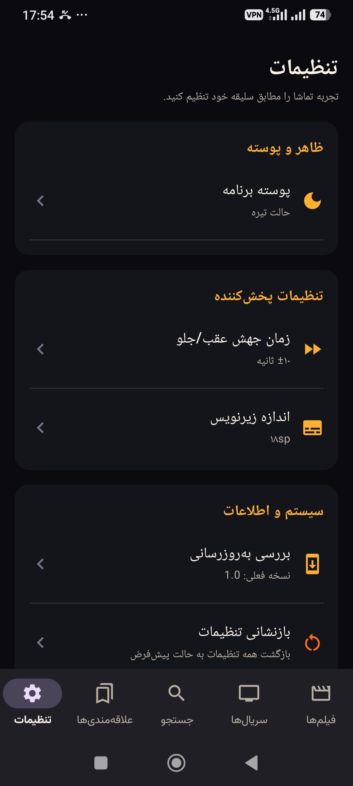
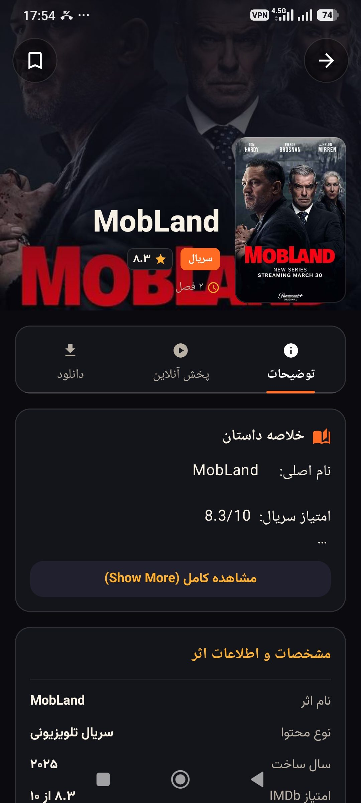

# Namager 🎬

Namager is an Android application for browsing movies and TV series, viewing title details, and exploring playback-related options through a Persian-cinema-focused interface.

> **Project context:** This repository is a customized fork of an upstream open-source project. The screenshots show the app’s interface; review the commit history to distinguish upstream functionality from changes made in this fork.

## Screenshots

| Movies | TV series |
| --- | --- |
|  |  |

| Title details | Settings |
| --- | --- |
|  |  |

## Highlights

- Browse movie and TV-series catalogs.
- Open a title’s details and view available information.
- Explore playback-related options in the interface.
- Adjust appearance and playback preferences in Settings.
- Dark, media-focused interface.

## Tech stack

- **Kotlin**
- **Jetpack Compose** for UI
- **Hilt** for dependency injection
- **Kotlin Flow** and lifecycle-aware state collection
- **Lottie** animation support

## Run locally

1. Clone this repository:

   ```bash
   git clone https://github.com/allii-safdari/Namager.git
   ```
2. Open the project in Android Studio.
3. Allow Gradle sync to finish.
4. Select an Android device or emulator, then run the app.

> Build requirements depend on the Gradle and Android SDK versions configured in the project.

## Attribution

Namager is based on an upstream open-source project. Credit for the original implementation belongs to its original authors. This repository documents the fork and its subsequent changes.

## License

Review the upstream project’s license and the license files included in this repository before redistributing or reusing code. No separate license is declared by this README.
